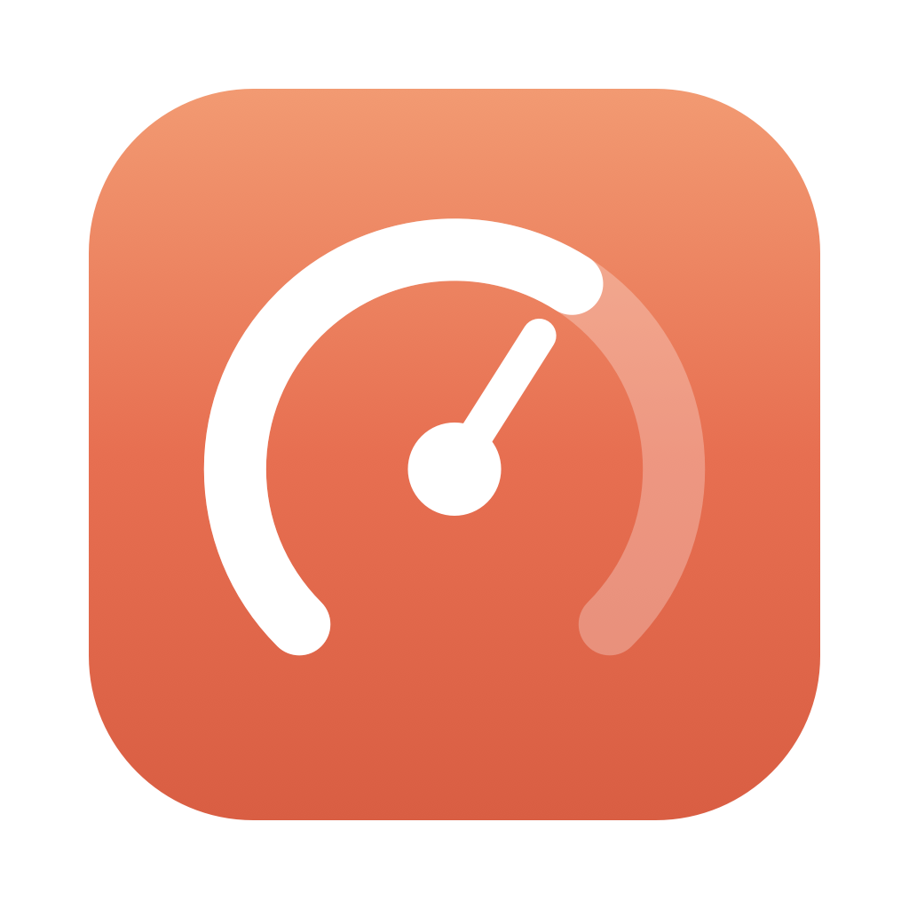
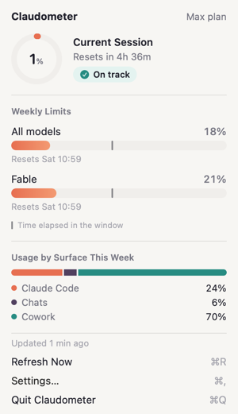
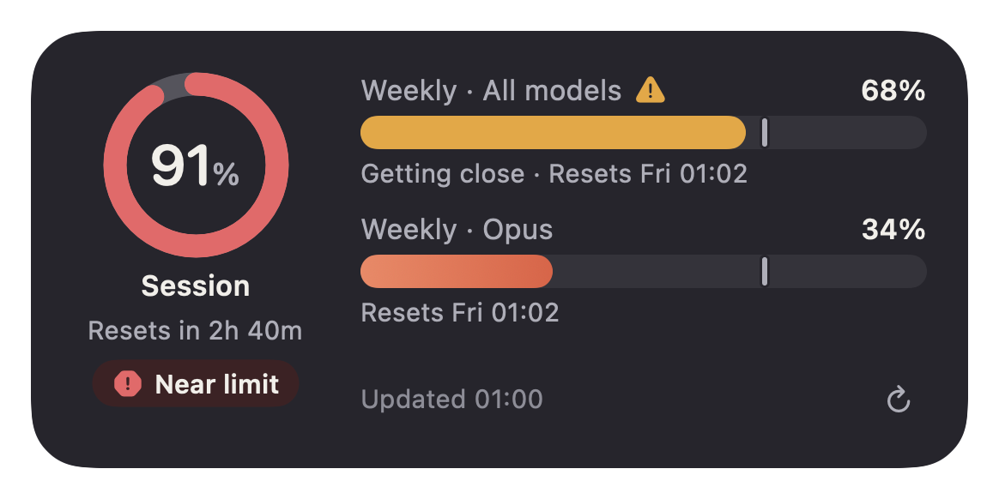

<p align="center"></p>

# Claudometer — unofficial Claude usage meter

A tiny macOS menu bar app (plus a desktop widget) that shows how much of your **Claude plan limits** you've used: the 5‑hour session window and the weekly windows, each with a reset countdown. When another limit runs high (say weekly at 80%), it gets its own lettered ring in the menu bar so you don't miss it, and in Settings you can keep weekly or per-model limits (like Fable) next to the session ring all the time. The popover also charts the last 7 days and, when you're using a limit fast, says when you'd hit it at this pace. Click any limit to copy all your limits as an image. Have a personal and a work account? Add up to three more with a claude.ai session key and switch between them in the popover. In English or Russian.

> **Unofficial.** Claudometer is an independent open-source project. It is not affiliated with, endorsed by or supported by Anthropic. It relies on an **undocumented** usage endpoint that may change or stop working at any time; if the format changes, the app says "Usage format not recognised" instead of showing wrong numbers.

<p align="center">
  
  <br><br>
  
  &nbsp;
  
</p>

## What it reads, and what it never does

**Reads**
- Your **Claude Code login token** from the macOS Keychain item `Claude Code-credentials`, **read-only**. Claudometer never changes or deletes it.
- Your usage from `api.anthropic.com/api/oauth/usage`, the same account endpoint Claude Code uses.
- It saves only usage numbers (the last percentages and reset times, plus about a week of history for the chart; no token) to `~/Library/Application Support/Claudometer/`, so the widget can show them.
- *Optional, off by default:* a claude.ai `sessionKey` you paste in yourself (see [claude.ai backup](#optional-claudeai-backup)).
- *Only when you save a session key:* the organization ID in Claude Code's `~/.claude.json`, to tell whether the key belongs to your Claude Code account or to [another account](#optional-more-accounts). Nothing else in that file is read.

**Sends** a check-in once a day, so the developer can count how many people use Claudometer: a random ID made on your Mac, the app version, language and macOS version. Nothing about your Claude account or usage, and the server stores no IP addresses and deletes rows after 90 days ([`server/checkin`](server/checkin/src/index.js)). To turn it off (this also forgets the ID), run `defaults write dev.claudometer.app sendCheckIn -bool false`.

**Never**
- Never writes a token or key to disk, `UserDefaults`, logs or the widget's folder. Tokens stay in memory; the optional session key lives only in Claudometer's own Keychain item.
- Never logs credentials or usage.
- Never talks to any server except Anthropic (`api.anthropic.com`, and `claude.ai` only if you enable the backup), GitHub (`api.github.com`, a daily anonymous check for new releases, and `github.com` when you install an update) and the check-in counter above (`claudometer-stats.claudometer.workers.dev`).
- No analytics SDKs, no tracking, no third-party services.

The code is short and open, so you can check all of this yourself: [`CredentialsProvider`](Sources/ClaudometerCore/CredentialsProvider.swift), [`UsageAPIClient`](Sources/ClaudometerCore/UsageAPIClient.swift), [`UsageService`](Sources/ClaudometerCore/UsageService.swift).

### About the Keychain prompt

The first time Claudometer reads Claude Code's login, macOS may show *"Claudometer wants to use your confidential information stored in 'Claude Code-credentials' in your keychain."* That's expected: it's how the app reuses your existing Claude Code login instead of asking for a password. Choose **Always Allow** so it doesn't ask on every check. You can revoke it any time in Keychain Access.

The full specification is in [TZ.md](TZ.md).

## Requirements

- macOS 14 Sonoma or later
- A Claude Pro/Max subscription and **Claude Code signed in** (`claude` → `/login`). Claudometer reuses that login.

## Install

Building it yourself (below) is the most transparent option. Prebuilt, ad-hoc signed builds are also available:

```bash
brew install --cask faithful-developer/tap/claudometer
# or, without Homebrew:
curl -fsSL https://raw.githubusercontent.com/Faithful-developer/claudometer/main/scripts/install.sh | bash
```

Both download the latest release, check it against the SHA-256 GitHub publishes, and install it to Applications without the Gatekeeper step below. You can also download `Claudometer-x.y.z.dmg` from [Releases](https://github.com/Faithful-developer/claudometer/releases) and drag the app to Applications.

**Updates:** Claudometer checks for new releases once a day, shows a dot on the menu bar icon and sends one notification per version. From the release after 0.2.0, **Install Update** in the menu (or *Settings → About*) downloads, verifies and installs it, then restarts the app.

### "Claudometer can't be opened" on first launch

Only for a DMG downloaded in a browser. The prebuilt app is not signed with an Apple Developer ID and not notarized (that needs a paid developer account, which this project doesn't have), so Gatekeeper blocks it the first time. Either:

1. Try to open the app once, then go to **System Settings → Privacy & Security**, scroll down to the message about Claudometer and click **Open Anyway**. Confirm with your password or Touch ID. Only needed once per version.
2. Or clear the quarantine flag in Terminal: `xattr -dr com.apple.quarantine /Applications/Claudometer.app`

Homebrew, the install script and **Install Update** skip this step. If you'd rather not trust a prebuilt binary, build it yourself below: the build is ad-hoc signed on your Mac, so Gatekeeper never asks.

## Build & run (no Xcode needed)

```bash
scripts/build-app.sh             # → build/Claudometer.app (universal, ad-hoc signed)
scripts/build-app.sh --install   # copy to /Applications and launch
scripts/build-app.sh --dmg       # also package build/Claudometer-<version>.dmg (designed window)
scripts/test.sh                  # unit tests (clean build; works around CLT macro-plugin bugs)
```

Swift Package Manager builds the menu bar app with only the Command Line Tools installed.

## Desktop widget (needs Xcode)

```bash
brew install xcodegen
scripts/build-xcode.sh      # app + widget → /Applications, launched
```

No Apple developer team is needed. The app and widget share data through `~/Library/Application Support/Claudometer/` instead of an App Group: the sandboxed widget has a read-only sandbox exception for that one folder. The shared code is linked statically into both, so library validation passes with local signing. After installing, right-click the desktop → **Edit Widgets…** → search "Claudometer".

## Optional: claude.ai backup

Claude Code refreshes its login only while it's running, so after about 8 hours with Claude Code closed the token expires and Claudometer shows the last known numbers. If you want usage to stay live anyway, paste your claude.ai `sessionKey` cookie in **Settings → Accounts** and press **Save & Test**.

- **Off by default.** Nothing happens unless you paste a key.
- Used **only** while Claude Code's login is expired or missing; Claude Code's login always comes first.
- Stored only in Claudometer's own Keychain item and sent only to `claude.ai`. **Remove** deletes it.
- It's your full claude.ai web session and the claude.ai endpoint is also undocumented, so skip this if you're not comfortable with that.

## Optional: more accounts

To watch another Claude account too (say a work Team plan next to your personal one), paste the `sessionKey` of a browser signed in to it under **Settings → Accounts → Add Account**. You can add up to three.

- The popover gets a switcher (⌘1…⌘4), and the menu bar shows the account you pick there.
- Each desktop widget shows the account you choose in **Edit Widget**.
- Limit and outage alerts cover every account, with its name in the title. Being offline gives a single alert.
- If the key turns out to be your Claude Code account, it's saved as that account's backup instead of being added twice. If the login has several organizations, you pick one.
- Each key gets its own Keychain item, sent only to `claude.ai`. **Remove Account…** deletes the key and that account's history.

## How it works

| Piece | What it does |
|---|---|
| `CredentialsProvider` | Reads Claude Code's OAuth token from the Keychain item `Claude Code-credentials` through `/usr/bin/security` (read-only; never stored or logged) |
| `ClaudeWebClient` | Backup source: claude.ai's usage API with the `sessionKey` cookie you paste in *Settings → Accounts*. For the Claude Code account, used only while its login is expired (Claude Code refreshes it only while running); added accounts always use it |
| `UsageAPIClient` | `GET https://api.anthropic.com/api/oauth/usage` with `anthropic-beta: oauth-2025-04-20` |
| `UsageDecoder` | Tolerant parsing. Prefers the `limits` array and falls back to the legacy `five_hour` / `seven_day*` keys. Unknown limit kinds are still shown |
| `UsageStore` | Polls every 5 min by default (1–30). Backs off exponentially on errors (1→2→4→8→15 min), honours `Retry-After`, and refreshes on wake or when the network comes back |
| `UsageHistory` | About a week of compact samples for the 7-day chart and the "at this pace" forecast |
| `NotificationManager` | Optional alerts at 80% / 95% (once per window per reset cycle) and when a limit resets; when usage stops updating (right away if you need to act, otherwise after 30 min); once per new version |
| `UpdateChecker` / `UpdateInstaller` | Daily check of GitHub Releases. **Install Update** downloads the DMG, checks its SHA-256 and code signature, swaps the app and relaunches |
| `SnapshotStore` | Last known state and history as JSON in `~/Library/Application Support/Claudometer/`, which the widget reads. Contains no token |
| `L10n` | All UI text, English and Russian (`Resources/Localization`). Follows macOS or *Settings → General → Language* |

## Project layout

```
Sources/ClaudometerCore/   models, decoder, API client, Keychain, backoff, thresholds, store
Sources/Claudometer/       SwiftUI menu bar app (MenuBarExtra), settings, notifications
Widget/                    WidgetKit extension (built via project.yml / Xcode)
Tests/                     swift-testing unit tests + real response fixture
Resources/                 app icon, Localization/{en,ru}.lproj, DMG/background.tiff
scripts/                   build-app.sh, build-xcode.sh, test.sh, release.sh, install.sh,
                           make-dmg.sh, dmg/ (DMG artwork source), make-icon.swift
Config/                    entitlements for the Xcode build
server/checkin/            Cloudflare Worker that counts the daily check-ins
TZ.md                      technical specification
```

## Design

Claudometer follows Apple's Human Interface Guidelines and looks like a built-in menu bar extra (Battery, Wi‑Fi, Control Center):
- **System look:** the window keeps the system material. Text uses hierarchical `.primary`/`.secondary`/`.tertiary` styles, so it picks up vibrancy, light/dark mode and Increase Contrast.
- **Light and dark:** follows the system by default. *Settings → General → Appearance* can pin Light or Dark.
- **Language:** English or Russian, following macOS unless *Settings → General → Language* picks one. The widget follows the app.
- **Colours:** from the Claudometer palette ([docs/palette.html](docs/palette.html)). Meters use Meter Coral; Attention amber and Over-limit red take over near limits; status pills (On track / Ahead of pace / Getting close / Near limit) use each status colour on its soft tint. Dark mode uses matching dark steps of the same hues.
- **Warnings:** system orange and red appear only above your thresholds, always with an SF Symbol and a label.
- **Menu bar icon:** monochrome like other system icons until usage needs attention.
- **Actions:** full-width menu rows with keyboard shortcuts (⌘R, ⌘,, ⌘Q) and an accent-coloured hover highlight.
- **Settings:** toolbar tabs (General, Notifications, Accounts, About) with grouped forms.
- **Meters:** capacity rings and bars, like the Batteries widget. A 2pt tick marks how much of the window's time has passed, so you can see your pace.
- **Usage by surface:** one stacked bar with a legend that lists each value. Series follow the palette order: Usage coral (Claude Code), plum (Chats), teal (Cowork). The dark steps were picked to keep the hues and still pass the data-viz colour-blind checks.
- **Shared code:** the components live in `Sources/ClaudometerCore/UI/`, so the popover and widgets match.

## Developer notes

- `Claudometer --render-previews <dir> [--sample high|rings|pinned|stale|expired|signedout|accounts] [--language ru]` renders the menu bar icon, popover, settings and all three widget sizes (light and dark) to PNGs, then exits. It uses the cached state, or made-up numbers: `--sample high` for high usage, `--sample rings` for two other limits high enough to get extra menu bar rings, `--sample pinned` for weekly and Fable added to the menu bar, `--sample accounts` for four accounts, the most there can be. It's used for the screenshots above.
- UI text goes through `tr("English text")`; add the Russian to `Resources/Localization/ru.lproj` (a test fails on missing keys).
- `swift scripts/make-icon.swift` regenerates `Resources/AppIcon.icns`.
- `scripts/release.sh 0.2.0 "notes"` builds the app with the widget, packages a DMG, tags `v0.2.0`, publishes the GitHub release and bumps the cask in [Faithful-developer/homebrew-tap](https://github.com/Faithful-developer/homebrew-tap). Always bump the version: the in-app update check compares it with the latest release.
- `scripts/make-dmg.sh` lays out the DMG window through Finder: the first run asks to let Terminal control Finder (and uses Accessibility, if allowed, to size the window exactly). The artwork is `scripts/dmg/background.html`; `scripts/dmg/render-background.sh` regenerates `Resources/DMG/background.tiff` (needs Chrome) and `scripts/dmg/mock.sh` previews it with Finder's light and dark labels.
- `Claudometer --install-update` installs whatever the first update check finds, for testing the update path from a build with a lower `VERSION`.
- Notifications and launch at login only work from the bundled `.app`, not from `swift run`.
- **Check-in counter** (`server/checkin`, Cloudflare Worker + D1): `npx wrangler@4 deploy` from that folder after `npx wrangler@4 login`. Stats at `/stats` (any user name, the `STATS_KEY` secret as the password; set it with `npx wrangler@4 secret put STATS_KEY`). Local test: `npx wrangler@4 dev --local` with `STATS_KEY=…` in `.dev.vars`.

## License

[MIT](LICENSE). "Claude" is a trademark of Anthropic; this project only refers to it to describe what it measures.
